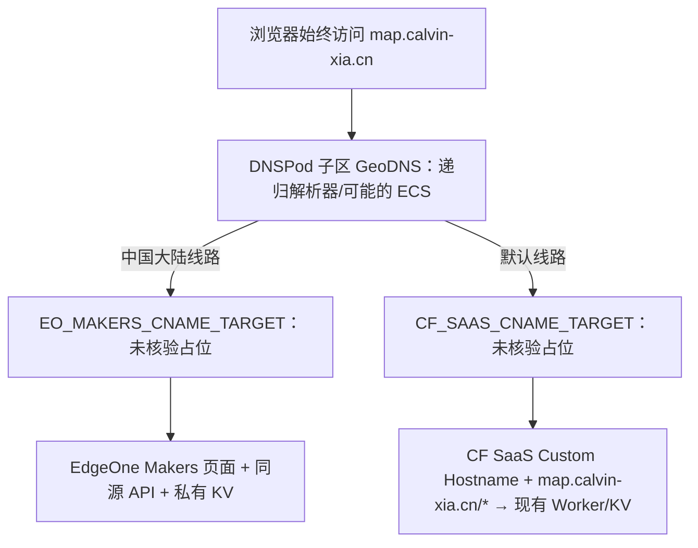
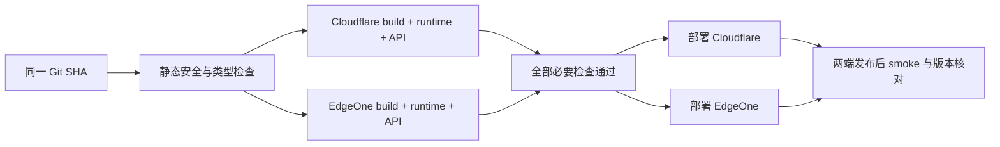

# EdgeOne + Cloudflare Workers 双平台部署与国内外分流方案

> 2026-10-15 15:03 实际进展：CF fallback、精确 map route、Custom Hostname 已建；map 子区改为华为云，两个 TXT 可公开解析，hostname/SSL 均 active。用户单独批准的根 CNAME 全网默认 → `map-fallback.calvin-xia.cn` 已生效（TTL 300），正常域名 HTTPS 页面与公共 API HEAD 200，Edge 地图和公开聚合加载成功。本文 DNSPod GeoDNS 部分为原策略历史；当前托管目标与验证见 [华为云记录](huawei-dns-verification-20261015.md)。本地新代码、真实数据、Secrets 与大陆线路尚未发布。

- 文档更新：2026-10-15（Asia/Shanghai）；保留 2026-10-14 的实现与验证历史。
- 状态：**2026-10-15 已接续本地实施：同 Host 会话适配、完整字体分片、只读预检与隔离路由候选。当前仍是未提交工作区；不部署、不改 DNS 或云端配置。验证范围见运行手册最新记录，SaaS 与真实平台门禁未通过。**
- 实际状态与上线门禁见 [实施操作包](dual-deployment-runbook.md) 和 [平台证据](edgeone-platform-evidence.md)；生产写操作仍待用户确认。
- 项目基线：`main`，提交 `d488775d38e6a7a0708166ebeb111176bbbe2797`。
- 适用范围：蹭饭地图的页面、静态资源、四个 API、数据存储、域名入口、发布和回滚。
- 用户决定：采用腾讯 EdgeOne；保留 Cloudflare Workers；优先考虑一个子域名自动分流，无法同时满足免费和大陆直连时接受跳转。
- 优先评估：**同一浏览器域名 `map.calvin-xia.cn` + DNSPod GeoDNS + Cloudflare for SaaS / Worker-as-origin + EdgeOne Makers**。存在官方 CDN 不兼容限制，必须先实测，不能作为已获平台支持的定案。
- 备选/回滚：保留原 `class1forever.calvin-xia.cn` 的国家 302 方案及独立 `class1forever-cn` / `class1forever-global` 域名。
- 根域 `calvin-xia.cn` 继续由 Cloudflare 托管，仅 `map.calvin-xia.cn` 子区委派 DNSPod。备案号、项目/接入目标、SaaS 状态、证书与运行时仍需核对；候选名称不是已创建资源。

## 阅读导航

- [1. 目标与验收标准](#1-目标与验收标准)
- [2. 当前基线与设计依据](#2-当前基线与设计依据)
- [3. 分流方式的选择](#3-分流方式的选择)
- [4. 域名、DNS 和 TLS](#4-域名dns-和-tls)
- [5. Cloudflare SaaS 接入与 302 备选](#5-cloudflare-saas-接入与-302-备选)
- [6. 应用代码与构建组织](#6-应用代码与构建组织)
- [7. 数据发布与一致性](#7-数据发布与一致性)
- [8. 认证、限流与缓存](#8-认证限流与缓存)
- [9. 双平台 CI/CD](#9-双平台-cicd)
- [10. 实施阶段与上线顺序](#10-实施阶段与上线顺序)
- [11. 验证与证据记录](#11-验证与证据记录)
- [12. 故障处理与回滚](#12-故障处理与回滚)
- [13. 配额与费用](#13-配额与费用)
- [14. 待实测事项与配置清单](#14-待实测事项与配置清单)
- [15. 官方资料与适用说明](#15-官方资料与适用说明)

## 1. 目标与验收标准

优先评估同一浏览器 URL `https://map.calvin-xia.cn/` 的双平台服务；下列是目标，不是已通过验收：

| 目标 | 验收标准 |
|---|---|
| 大陆访问 | DNSPod 中国大陆线路回答 EdgeOne 实际接入目标，页面/资源/同源 API 由大陆项目承接；无国家 302，需实际网络验证 |
| 全球访问 | DNS 默认线路回答 CF SaaS 接入目标，以 `map.calvin-xia.cn/*` 路由进入现有 Worker；不能只 CNAME 到 workers.dev |
| 功能等价 | 地图下钻、缩放、地区一览、弹窗、口令、退出、分享图、键盘和触摸契约保留 |
| 明细保护 | 匿名只能获取聚合，学生明细仅在认证后按地区返回 |
| 数据一致 | 两端激活同一数据发布版本，聚合和原始数据通过受控校验 |
| 免费目标 | 正常班级访问在两平台免费额度内；实际消耗上线后测量 |
| 回滚 | 受控撤回大陆 DNS 线路并等待 TTL/负缓存；SaaS 不可用时采用已验证的独立直达/302 备选，代码与数据分别回滚 |
| 可复现 | 演示夹具、API 契约、产物检查、浏览器验收均覆盖两平台 |

GeoDNS 按递归解析器及可能的 ECS 分线路，不承诺每次根据用户真实地理位置精确选路。第一阶段不承诺全球严格同步、全球原子限流、自动健康切换或任何付费 SLA。免费方案成立的前提是账号具备对应免费权益且用量未超限。

## 2. 当前基线与设计依据

### 2.1 本轮探查得到的项目状态

| 项目 | 2026-10-14 探查结果 |
|---|---|
| Git | `main` 与 `origin/main` 一致，Astro 迁移已由 PR #5 合并 |
| 页面 | Astro 6.4.8，React 19.3.0，TypeScript 5.9.3 |
| 地图 | ECharts 6.1.0，Vite 7.3.7 打包，31 个省级几何按需加载 |
| Cloudflare | `@astrojs/cloudflare` 13.7.0，Wrangler 4.149.0 |
| 运行方式 | Astro SSR + 单个 Worker + Workers Assets + `CLASS_MAP_DATA` KV |
| API | `src/pages/api/**` 中的四条路由 |
| 首页 | `src/pages/index.astro` 装配页面；数据和登录状态由浏览器请求 API |
| 数据源 | 本地 `js/data.js` 或 `STUDENTS_DATA`；明细不进入静态资源 |
| 构建检查 | `npm run check` = build + runtime + API contract |

同一会话前序探查验证过 Worker 地址：

- [当前 Worker](https://class1forever.calvin-xia.workers.dev/)：首页、公开 API 返回 200，匿名详情返回 401。
- [当前提交 CI](https://github.com/Calvin-Xia/class1forever/actions/runs/38360244481)：成功。
- [当前提交 Worker 部署](https://github.com/Calvin-Xia/class1forever/actions/runs/38360244458)：成功，2026-10-13 15:03（北京时间）。

这些是探查时的读数，不是本文所述双平台方案已经上线的证据。真实口令登录未在该探查中验证。

现有 `docs/cutover-runbook.md` 记录的是上一轮 Pages → Worker 迁移。其“未合入 main”等历史状态不能作为本方案的当前部署状态；原记录保留作历史证据。

### 2.2 为什么大陆端可以用静态首页

页面没有需要逐请求计算的服务端用户内容。首页的地图聚合、登录状态和明细均经 API 获取。因此大陆端可预渲染页面壳，同时继续提供动态 API；这不意味着把学生数据静态化。

Cloudflare 端继续保留现有 SSR 部署方式。两端可共享页面组件和浏览器代码，不要求 SSR 与 SSG 产物逐字节相同，但必须达到相同功能和安全契约。

### 2.3 本次必须一起解决的外部依赖

既有实现已将原 Google Fonts 依赖改为同源 WOFF2；本次继续实现完整 cmap 的 unicode-range 分片、哈希长缓存、地图与分享图字体等待。保留完整源、字重轴和 OFL，不按页面文案或名单裁字；不迁移 Makers Blob。覆盖与重建步骤见 [字体说明](font-subsets.md)。

地图几何、同源脚本策略、视觉规范和已裁定的触摸行为沿用仓库现有契约。不要在平台迁移中顺便修改地图几何或重开台湾轻点的等价性裁定。

## 3. 分流方式的选择

### 3.1 同域名方案与官方边界

| 方式 | 地址不变 | 大陆直达 EdgeOne | 当前定位 |
|---|---|---|---|
| DNSPod GeoDNS + CF for SaaS | 目标是同一 map 域名 | 大陆线路直接指向 EO 时可以，需实测 | **优先评估；官方存在另一 CDN 不兼容限制，可能失败** |
| Dashboard 国家 302 | 否，导航到 cn/global | 最终 cn 域名直接指向 EO 时可以 | 已设计的备选/回滚方案，非当前主推 |
| Worker 按 country 代理 EO | 是 | 否，请求仍经 Cloudflare | 不能称为大陆直连 |
| 免费 Origin Rules 改回源 | 是 | 否，仍经 CF；DNS/Host/SNI 覆写受套餐限制 | 不采用；不将免费入口误作覆写权限 [S1] |

Cloudflare 官方明确规定：使用另一 CDN 的 Custom Hostname 与 CF for SaaS 不兼容；另一 CDN 遮蔽 DNS 时 hostname validation 会失败。这不是“官方只是没推荐”。分线路下同一个 Host 同时指向 EO 与 CF 正是必须先实测的风险组合；分享和博客案例不能推翻该限制。[S21]

必须分别证明 Custom Hostname 的 ownership/status 与 ssl.status 均 active，并在实际大陆/境外 DNS 回答下验证两端 HTTPS。即使某次验证通过，也不能据此承诺 GeoDNS 永久满足签发、续期或持续兼容。失败时停止启用大陆线路，退回已验证的独立站点方案。

### 3.2 候选访问路径



根域权威 DNS 留在 Cloudflare，只委派 map 子区。大陆链路不经过 CF 普通代理；默认链路进入 CF SaaS，二者不可混称。主机/Origin 都是 map.calvin-xia.cn；同源 /api 相对 URL 保留，但 Cookie 不再因 cn/global 两个 Host 自动隔离，见 §8.1。

DNS 选择发生在解析时，不是每个 HTTP 请求按 ip.src.country 计算。公共 DNS 出口、VPN、ECS 支持、递归缓存和已有连接会影响落点；不保证 CN 用户永远命中 EO。任何“直连大陆”判断需结合最终地址、实际平台落点与 HTTPS，不只看浏览器域名。

### 3.3 原 302 方案保留

原入口 class1forever.calvin-xia.cn 的两条 Single Redirects，及独立 class1forever-cn / class1forever-global 域名仍按 §5 的备选部分保留。只有用户确认转用该方案才配置/启用；当前入口已有 CNAME，不能直接覆盖为无源站占位。

302 按 HTTP 出口 IP 国家匹配，可用 CN → cn、其余/未知 → global；首次入口仍需连接 CF。备选的入口路径/方法拦截仅作用于 class1forever.calvin-xia.cn，**不得套到同域名应用 map.calvin-xia.cn 的 /api 或 POST 上**。

## 4. 域名、DNS 和 TLS

### 4.1 已核实的 DNS 现状（2026-10-15）

下表来自侧边对话的只读检查交接，本轮只核对文档和官方资料，没有再次修改/读取账号配置：

| 位置 | 已核实事实 | 可以得出的结论 |
|---|---|---|
| CF 父区 calvin-xia.cn | 两条 DNS-only NS：map.calvin-xia.cn → f1g1ns1.dnspod.net / f1g1ns2.dnspod.net，TTL Auto | 委派记录已存在；无需要求重加 NS，更不更换根域 NS |
| DNSPod map.calvin-xia.cn 子区 | 解析设置“正常”；当前/分配服务器均为上述两台，显示“域名已正常解析”；记录管理为 0 条 | 控制台子区存在但为空，尚无业务 CNAME；控制台状态不等于业务已可用 |
| Google DoH 的 map NS/SOA | NXDOMAIN，注明 Response from 36.155.149.35 / 111.206.98.235；另查这些 IP 属于 f1g1ns2.dnspod.net | 查询已到 DNSPod；子区回答是当前问题位置，空区是明显因素，尚未证明是唯一原因 |
| 本机 nslookup | gabe.ns.cloudflare.com 被解析成 198.18.5.157 等代理 Fake-IP | 先前所谓“直查权威 NS”受代理干扰，不能当作父区未发布委派的证据 |
| 既有 class1forever.calvin-xia.cn | CNAME → calvin-xia.cf.090227.xyz | 入口不是完全未配置；本轮保留，不假定该目标就是本项目的 SaaS 接入目标 |
| CF 支付资料 | 用户已确认存在 | 不再列为缺失前置条件；不代表 SaaS 已启用或 Hostname/证书已 active |

官方子域委派方式支持父区 NS 与外部子区分开管理。[S13] 递归 NS/SOA 的 NXDOMAIN 不应逆推出“CF 没有 NS”。下一次在获得实际接入目标和写入授权、添加合法解析记录后，再验收父区委派、子区 NS/SOA/CNAME 回答与多个递归解析器；在此之前保留诊断的不确定性。

### 4.2 候选 DNS 与域名分工

| 区域/主机记录 | 线路/类型 | 候选目标或当前状态 |
|---|---|---|
| CF 父区 map.calvin-xia.cn | DNS-only NS | 已有两台 DNSPod NS，保留；其他根区记录不迁移 |
| DNSPod 子区 **@** | 默认 / CNAME | **CF_SAAS_CNAME_TARGET**：未创建/核验，填写实际 SaaS 接入目标后才可操作 |
| DNSPod 子区 **@** | 中国大陆 / CNAME | **EO_MAKERS_CNAME_TARGET**：未核验，取实际 Makers 项目接入目标，不指到 CF 代理 |
| CF 候选 map-fallback.calvin-xia.cn | proxied originless AAAA 100:: | 候选 fallback origin 名称，不是已存在资源；须按官方 Worker-as-origin 配置与验证 |
| CF 候选 map-saas.calvin-xia.cn | SaaS 接入别名（如采用） | 候选名称，非已存在/已分配资源；具体记录随实际 SaaS 配置核验 |
| class1forever-cn / class1forever-global.calvin-xia.cn | 独立站点 | 备选/回滚直达域名，接入/TLS 仍待验证 |
| class1forever.calvin-xia.cn | 既有 CNAME | 本轮不更改；原国家 302 仅保留设计 |
| class1forever.calvin-xia.workers.dev | 已有 Worker 地址 | 保留诊断与回滚服务 |

在 DNSPod 的 map.calvin-xia.cn **子区**里，主机记录是 @，不是再填 map；验证记录也应相对于这个子区填写实际标签。子区根 CNAME 与 NS/SOA 的平台处理、线路分类、CAA 和所有验证记录都需实测；占位字符串不是真实 DNS 目标，不可提交。DNSPod 文档支持基本境内/境外线路，实际控制台“中国大陆”选项与港澳台/未知来源边界需核对，不沿用 302 的精确国家分类承诺。[S12]

### 4.3 接入与证书门禁

- 用户有支付资料，但 SaaS 启用/权益/账单、fallback origin active、Custom Hostname ownership/status active、ssl.status active 分开记录。不能以支付资料或 CLI 登录代替这些门禁。
- CF SaaS Zone 留在 calvin-xia.cn；Custom Hostname 是 map.calvin-xia.cn，不等于 SaaS Zone 名。使用官方 Worker-as-origin 结构，在该 Zone 配置 `map.calvin-xia.cn/*` → 现有 class1forever Worker 的精确路由，不用全区 */* 接管其他项目；不能仅 CNAME 到 workers.dev。[S20]
- EO 真实大陆区域/免费权益/备案、同 Host 的接入验证与证书仍待确认；KV 审核继续等待。页面备案号不能虚构。
- EO 免费证书的自动 CNAME 验证明确要求避免分线路/分区域解析；应核查并优先评估控制台 **DNS 委派 DCV**，记录实际验证 CNAME 和续期要求，不盲用自动验证。[S23]
- CF 非 wildcard Hostname 指向 SaaS 目标后会尝试 HTTP DCV。CA 必须能拿到 CF 的挑战响应，CAA 不应阻挡所选 CA；GeoDNS 可能把验证请求送到 EO，因此不能承诺自动签发/续期一直成立。[S22]
- 逐项协调 ownership TXT/HTTP 与证书 DCV，避免两端争用同名 _acme-challenge CNAME。记录两平台实际标签/目标；冲突时暂停并另选经过验证的方式，不能用覆盖另一端记录来“通过”一次验证。
- 设定证书到期/续期失败监测与人工回滚流程；本轮只写要求，不创建监测、签发证书或切换线路。最终使用正常 TLS 校验验收两端相同 map Host，不使用 -k 或强制忽略证书错误。

## 5. Cloudflare SaaS 接入与 302 备选

### 5.0 优先评估的 SaaS 配置顺序（待授权、待实测）

1. 记录现有父区委派、空子区、旧入口 CNAME 与原 Worker 配置，保留原资源；不重复创建 map NS。确认 SaaS 启用/权限/权益，支付资料已确认存在。
2. 按官方 Worker-as-origin 创建并验证实际 fallback origin；map-fallback / map-saas 仅为候选命名，取已核验的接入目标填入 DNSPod 子区 @ 默认线路。
3. 添加 map.calvin-xia.cn Custom Hostname，分别完成 ownership 与证书验证；为该 Host 配 map.calvin-xia.cn/* → class1forever Worker，确认首页、资源与四 API。现有 wrangler.jsonc 尚无此 routes 配置，本轮不改。
4. 在 EO 核对同 Host 的接入和 DNS 委派 DCV；解决验证标签冲突，待两端证书/续期条件和应用门禁通过后，再申请启用 @ 中国大陆线路。
5. 实测 CDN 不兼容限制、不同地区/解析器回答、两端 TLS 和 Cookie 切线；任一关键失败停止推广同域名方案，按 §12 回退。一次临时切到 CF 完成验证不是永久兼容或续期保证。

以下 §5.1–§5.6 **仅是原 302 备选**，不为 map.calvin-xia.cn 启用跳转或入口 WAF。原 class1forever 入口已有 CNAME，执行备选前必须另获授权并备份，不能直接添加 AAAA 与其冲突。

### 5.1 302 备选配置前记录

导出或截图现有 DNS、Single Redirects、Bulk Redirects、Page Rules、Cache Rules 和 Worker 域名绑定。检查是否已有泛域名跳转、强制 www 跳转或“缓存所有内容”，避免覆盖本方案。

规则名称建议固定为 `classmap-mainland-entry`、`classmap-global-entry` 和 `classmap-entry-invalid-request`。上线记录保存实际规则 ID，不在本文件编造。

### 5.2 第一条：大陆首页

在 Zone 的 Rules → Redirect Rules / Single Redirects 新建规则。使用自定义过滤表达式：

```text
(http.host eq "class1forever.calvin-xia.cn"
 and http.request.uri.path eq "/"
 and http.request.method in {"GET" "HEAD"}
 and ip.src.country eq "CN")
```

| 动作字段 | 值 |
|---|---|
| 目标类型 | Static |
| 目标 URL | `https://class1forever-cn.calvin-xia.cn/` |
| 状态码 | `302` |
| Preserve query string | 开启 |
| 顺序 | 在全球兜底规则之前 |

### 5.3 第二条：全球兜底首页

```text
(http.host eq "class1forever.calvin-xia.cn"
 and http.request.uri.path eq "/"
 and http.request.method in {"GET" "HEAD"})
```

| 动作字段 | 值 |
|---|---|
| 目标类型 | Static |
| 目标 URL | `https://class1forever-global.calvin-xia.cn/` |
| 状态码 | `302` |
| Preserve query string | 开启 |
| 顺序 | 紧随大陆规则 |

第一条命中的请求已结束规则处理，第二条覆盖其他国家和未知值。Free 当前提供 10 条 Single Redirects；官方有按国家跳转子域名示例。[S2][S3]

### 5.4 入口的非法路径和方法

在 Security/WAF 的自定义规则中，使用 Block 动作：

```text
(http.host eq "class1forever.calvin-xia.cn"
 and (http.request.uri.path ne "/"
      or not (http.request.method in {"GET" "HEAD"})))
```

期望：入口仅接受首页 GET/HEAD。访问入口的 `/api/*` 或向入口 POST 被拦截，而不是把 API、口令请求或请求体跨站重定向。该规则消耗一条 WAF 自定义规则配额，需检查是否仍有额度。

此限制只作用于备选入口 `class1forever.calvin-xia.cn`，不能扩展到 `map.calvin-xia.cn`、`cn` 或 `global`。若已有规则配额不足，不要把入口无源站的异常返回当作正式方案；应解决配额或为入口补充明确的错误响应实现后再验收。

### 5.5 缓存、排序与未来路径

- 不使用 301/308 固化按地理位置作出的选择。
- 入口不启用 Cache Everything，不缓存国家选择结果。
- 全局根域、www 等既有跳转须明确优先级，不能把 `cn`、`global` 重定向回同域名应用或制造入口循环。
- 当前仅 `/` 是页面入口。将来增加文档路径时，在页面路径白名单内扩展跳转；API 和写请求仍排除。
- 保留查询字符串只用于非敏感导航参数；口令、Cookie、令牌不放 URL。

### 5.6 302 备选边界行为表

| 请求 | 期望 |
|---|---|
| CN → `class1forever/` GET 或 HEAD | 302 → `cn/` |
| 非 CN / 未知 → `class1forever/` | 302 → `global/` |
| `class1forever/?x=1` | 目标保留 `x=1` |
| 任意地区 → `class1forever/api/map/public` | Block，无跨站 Location |
| 任意地区 → `class1forever/` POST | Block，无跨站 Location |
| CN → `global/` | 全球站可直接使用 |
| 境外 → `cn/` | 不触发本方案的反向跳转；可达性取决于 EdgeOne 接入区域 |
| 用户自己填写 `CF-IPCountry` | 不改变真实规则分类 |

### 5.7 使用已安装的 Cloudflare CLI `cf`

2026-10-14 本机确认已安装官方 npm 包 `cf`，版本 **1.0.0-beta.17**，Windows 入口为 `cf.cmd`。它可直接管理 Cloudflare DNS、规则集等资源，与 Dashboard 操作同一控制面，不需要先迁移现有 Wrangler 项目。[S17]

本机已执行命令帮助、匿名命令搜索及下列查询的 `--dry-run`，确认对应 GET 请求路径。用户登录后，2026-10-14 实际执行 `cf.cmd zones list --name calvin-xia.cn`，取得该 Zone 的 `active` / `Free Website` 状态；**DNS/规则写权限未验证，线上配置未修改**。后续可用：

```powershell
# 查找命令：搜索只描述动作，不填写真实域名、账号 ID 或凭据。
cf.cmd cli search "list DNS records"

# 已登录且具备相应读取权限时，查看域名和现有配置。
cf.cmd zones list --name calvin-xia.cn
cf.cmd dns records list --zone calvin-xia.cn
cf.cmd rulesets list --zone calvin-xia.cn
cf.cmd rulesets get RULESET_ID --zone calvin-xia.cn

# 无需凭据的请求预览；把 ZONE_ID 换成实际 ID。
# dry-run 不解析域名，不能据此证明域名存在、权限可用或规则已生效。
cf.cmd dns records list --zone ZONE_ID --dry-run
cf.cmd rulesets list --zone ZONE_ID --dry-run

# 查看规则更新的 API 参数，而不是直接执行更新。
cf.cmd schema rulesets update
```

DNS 列表是分页结果，完整备份需检查 `--page` / `--per-page`；规则集先 list，再 get 保存具体规则内容。命令输出按配置证据管理，凭据不写进命令或文档。写操作先查看该版本的 `--help` / `cf schema` 并预览，更新规则集须保留已有其他规则。[S17]

`cf` 与 Wrangler 使用各自登录凭据；需要时再运行 `cf.cmd auth login`。`cf` 当前仍为 Beta，项目级 `cf dev/build/deploy` 涉及 `cloudflare.config.ts` 和迁移流程，本方案继续用仓库已有 Wrangler 命令，**不执行 `cf migrate`，不改构建和 CI**。[S18]

用户说明本次 cf 登录令牌约 1 小时到期；执行真实查询或变更前检查认证是否仍有效，过期时再登录，不要求提前反复登录，也不把令牌写进本文。

CLI 不改变 Cloudflare 套餐权限：安装 `cf` 不会让免费账号获得 Origin Rules 的 DNS/Host/SNI 覆写能力，§3 的 GeoDNS/SaaS 评估与国家跳转备选分别受各自门禁约束。

## 6. 应用代码与构建组织

### 6.1 共用逻辑与平台边界

将现有服务端代码里的平台绑定与业务逻辑分开；共用模块不能导入 `cloudflare:workers` 或把 `Cloudflare.Env` 作为唯一环境类型。

拟定接口如下，仅作实现契约，不代表已经存在：

```ts
interface ClassMapStore {
    getText(key: string): Promise<string | null>;
    getJson<T>(key: string): Promise<T | null>;
    putText(key: string, value: string, expiresAt?: number): Promise<void>;
    delete(key: string): Promise<void>;
}

interface ClassMapRuntime {
    store: ClassMapStore;
    passphrase: string;
    sessionSecret: string;
    detailsHint: string;
    dataReleaseId: string;
    clientIp: string;
}
```

`ClassMapRuntime` 是服务端依赖，不得传入 Astro 页面 props、React props 或浏览器模块。逻辑键由存储适配器转换为平台允许的实际键。

| 层 | 责任 |
|---|---|
| 页面组件与浏览器逻辑 | 保留当前地图、对话框、分享与无障碍行为 |
| 通用请求处理器 | 参数校验、HTTP 契约、数据筛选、认证和错误分类 |
| Cloudflare 适配 | 从 `cloudflare:workers` 读取 env，使用现有 KV 和可信 IP |
| EdgeOne 适配 | 从真实 Makers 运行时读取变量/KV；获取平台可信客户端 IP |
| 发布工具 | 一次生成数据，按两种控制面上传并校验 |

### 6.2 页面入口

Cloudflare 保留 `src/pages/index.astro`、SSR 和四个 Astro API。

大陆目标增加独立 Astro 配置和薄页面入口，引用同一页面装配组件。该构建输入不包含 Cloudflare API 端点与 Cloudflare 中间件，从而避免静态构建误导入服务端平台模块。首页以 SSG 构建，不引入整页 Node SSR。

拟新增组织示例：

```text
astro.edgeone.config.mjs              # 拟新增：大陆 SSG 配置
platforms/edgeone/pages/index.astro   # 拟新增：共用页面的薄入口
platforms/edgeone/handlers/           # 拟新增：边缘路由包装
src/lib/server/                      # 拟整理：平台无关服务端逻辑
src/lib/platform/                    # 拟新增：两平台适配
scripts/build-edgeone.mjs            # 拟新增：静态页与边缘函数组装
scripts/publish-data.mjs             # 拟新增：两端数据发布协调器
```

这不是要求重写所有当前文件；实施时尽量保留现有路径，新增薄适配层。具体文件清单由实现 diff 确认。

### 6.3 两套构建产物

- Cloudflare：继续使用 `dist/` 和现有 Worker 构建入口。
- EdgeOne：使用独立的 `.edgeone-build/`，组装静态输出和 `edge-functions/api/**`。
- EdgeOne 接收的边缘函数为已打包 JavaScript；TS 业务模块在构建时编译，不能假设平台运行时直接执行 TS。
- 边缘 API bundle 不包含 ECharts、全国/省级几何或浏览器组件。
- Node 构建环境优先统一为 24；若平台只能选择 22，则要求具体版本满足 Astro 的 `>=22.12.0`，不能只核对主版本。
- `.edgeone-build/` 等新产物目录在实施时加入忽略规则。
- 生成的首页仍放产物目录，仓库根 `index.html` 继续保持归档，不恢复旧入口。

EdgeOne 项目根目录、静态输出目录、函数发现规则及 CLI 部署方式必须先用无敏感数据的最小项目实测。本文不假定把 `edge-functions` 放进任意输出目录就能被识别。

### 6.4 四路由契约

| API | 正常行为 | 必须保留的失败行为 |
|---|---|---|
| `GET /api/map/public` | 聚合 + 登录状态 + 提示 | 缺数据 503，不返回明细 |
| `GET /api/map/details` | 验证会话后按省/城市筛选 | 无会话 401，坏参数 400，缺数据 503 |
| `POST /api/auth/details` | 口令校验、计数、签发 Cookie | 坏 JSON 400，错口令 401，限流 429 |
| `POST /api/auth/logout` | 清空本站 Cookie | 不允许错方法成功；保留同源保护 |

现有 API 测试中的 JSON POST、无 Content-Type POST、Origin 与 Cookie 行为要逐项核对。不能用“新增一个一律要求 Origin 的检查”替代现有 Astro 行为而不记录契约变化。边缘端没有 Astro 中间件自动保护，应明确实现并验证对应规则。

### 6.5 本机 EdgeOne CLI 的已确认用法

2026-10-14 本机确认 npm 包 `edgeone` 版本 **1.6.41**。已执行 `edgeone -h`、Makers/部署/关联命令帮助以及 `edgeone.cmd whoami`（退出码 0，身份输出未记录）；用户已完成登录，尚未验证真实项目部署权限。

```powershell
edgeone.cmd -h
edgeone.cmd makers -h
edgeone.cmd makers deploy -h
edgeone.cmd makers link -h
edgeone.cmd whoami
```

- 新版使用 `edgeone makers`；`edgeone pages` 是过渡期的旧别名，新实现使用 Makers 命令。[S19]
- `edgeone makers link --name PROJECT_NAME` 将本地目录关联项目，用于 KV 和环境变量调试；它可能写本地状态、引导创建项目，在实施阶段再执行。
- `edgeone makers deploy [directoryOrZip]` 接收目录或 ZIP；**若更新已有项目，该项目必须为直接上传类型**。本方案若由受控 CLI/CI 发布，应创建或选择该类型，不能假定 Git 导入项目能由同一命令更新。
- `--env` 只接受 `production` / `preview`，默认是 `production`。预览部署必须明确指定 `--env preview`；首次验证不裸运行 `deploy`。
- CLI 的 `--area` 仅列出 `global` / `overseas`，不提供 `mainland` 选项；不能用命令默认值代替“仅大陆可用区已生效”的确认。项目区域与部署参数如何相互作用列入 G6 实测。
- CLI 提供 `--skip-ai-gateway-sync`，可跳过与本项目无关的 AI Gateway 密钥同步和云凭据绑定；部署地图时使用该开关。
- `--json` 可供发布记录读取；Token 从受控认证环境配置，不在聊天、文档或公共日志中传递。
- 本机帮助没有列出 KV 管理子命令；KV 申请、命名空间绑定与控制面自动上传仍需按 §7、G2/G3 验证，不能把安装 CLI 当作已具备这些能力。

以上仅做帮助和身份读取，没有运行 `init/link/create/deploy/env`，没有创建项目、导出环境变量或部署代码。

### 6.6 实施核查后的 Makers 配置差异

本机 CLI 1.6.41 的合并函数把 `context.env` 写为构建时 JSON；官方环境变量文档也说明变量变更仅影响新部署。为保留生产密钥不进入构建产物的要求，EdgeOne 不从该对象读取口令或会话密钥，改为通过全局私有 KV 绑定读取 `classmap_runtime_config`。该 JSON 仅在受控平台存储中保存 `DETAILS_PASSPHRASE`、独立 `DETAILS_SESSION_SECRET`、`DETAILS_HINT`、`DATA_RELEASE_ID`。配置键可以由非敏感 `CLASS_MAP_CONFIG_KEY` 在构建时选定，默认使用上述固定键。

每个请求读取一次配置后固定本次版本；配置缺失/非法版本返回 503，缺可信 IP 拒绝登录。Cloudflare 继续使用原生运行时 env / Secrets。EdgeOne 生产配置的写入、读取、访问隔离和传播延迟与真实 KV 绑定一起列入 G2/G3/G5，不把本地演示读取当成平台已通过。EdgeOne 激活新数据版本是更新该私有配置中的发布 ID，并完整保留本站密钥；部分失败时恢复先前配置，不能只恢复代码部署。

## 7. 数据发布与一致性

### 7.1 唯一来源与静态隔离

完整学生数据继续来自受保护的本地文件或环境变量。生成过程复用 `shared/data-model.mjs`；一次生成 raw/public 的相同字节，不能让两平台上传脚本分别生成不同 `generatedAt`。

代码 CI 不依赖真实学生数据。演示数据可以用于测试；真实明细不进入 Git、静态目录、公开构建 artifact、客户端 JS 或日志。数据发布独立于代码发布。

### 7.2 发布版本与键

为两端引入非敏感 `DATA_RELEASE_ID`，例如一段发布 ID 或随机标识。它不复用当前 JSON 中的 `version` 字段：原 `version` 属于数据格式契约，未经确认不改变其语义。

物理键示例：

```text
students_raw_<releaseId>
students_public_<releaseId>
```

`releaseId` 限定为数字、字母、下划线，并检查长度。Cloudflare 既有 `students:raw:v1` / `students:public:v1` 初期保留，供旧版回滚；新读取逻辑切换前要准备相应版本数据。

EdgeOne 配额页给出单值 1MB，而 KV 接口说明仍有 25MB 的文字。首次实施按较严格的 **1MB** 校验，记录实际控制台限制，不以较大的旧说明作容量承诺。[S7][S8]

### 7.3 发布事务的实际边界

1. 规范化输入，固定 `generatedAt`，生成两份数据和私有 manifest。
2. 校验格式、条数、地区统计、单值长度；计算两份内容哈希。
3. 向 Cloudflare 上传新的版本键；向 EdgeOne 上传同一字节。
4. 在受控发布进程读回新键，比对内容哈希和聚合统计。
5. 先保证两端完整数据存在，再逐端设置/部署新的 `DATA_RELEASE_ID`。
6. 验证公开响应版本标识、受控认证详情和运行状态。
7. 两端均通过后将发布记录标为成功；保留上一版本。

**两云之间没有原子事务。** 上述顺序防止读到未写完的一对数据，但激活期间两端仍可能短暂处于不同版本，跨请求也可能遇到部署切换。每次请求固定本次使用的发布 ID，不在一次请求中混读多个版本。

记录两端状态，例如 `uploaded` / `verified` / `activated`。若只有一端激活成功，发布状态必须是“部分失败”，按回滚流程恢复，不能报成功。

私有 manifest 包含版本、时间、来源标记、统计与内容哈希；不得包含凭据。真实内容哈希仅用于受控发布核验，不需要暴露为公开接口。

### 7.4 控制面与数据留存

- Cloudflare 可沿用 Wrangler KV 上传能力，但更新成版本化键和协调发布。
- EdgeOne 必须确认 **Makers/Pages KV** 的控制面上传与读回能力。不能直接把网站安全加速 KV 的 `EdgeKVPut` 当作同一种存储接口使用。
- 若没有可用的受控自动化接口，首轮采用控制台导入并记录，数据规模小不影响可行性；自动化作为后续能力，不宣称已完成。
- 写权限只保存在本地受控环境或批准的发布环境；浏览器和应用普通用户不获得写权限。
- 原始数据的临时文件使用私有路径、短期保留，失败时有明确处理；不将完整数据输出到命令日志。
- 大陆节点接入不等于 KV 只在大陆持久化。公开资料没有足够明确的地域承诺，如需要严格数据留境，应单独取得供应商确认。
- 保留 Cloudflare 明细副本意味着数据仍有境外平台副本；这与“所有数据只存大陆”的目标不兼容，不能同时宣称两者成立。

### 7.5 KV 开通申请理由（历史草稿，审核仍待完成）

根据用户提供的控制台截图，申请表要求预计存储量、预计查询率与使用场景。以下数字是按小规模班级网站作出的**容量与流量预估，不是实测读数**；用户可按真实需求调整后提交：

```text
1. 预计存储数据量：初期不超过 1MB，预留 10MB 用于历史版本和短期限流记录。
2. 预期查询率：正常访问低于 1 QPS，短时峰值预计不超过 10 QPS。
3. 使用场景：个人班级同学分布地图，当前约 44 条记录。使用 Makers Edge Functions 读取 KV 中的省市聚合数据；姓名和学校等明细仅在口令验证后按地区返回。同时保存短期登录失败计数。数据更新频率低，不存储图片、视频等大对象。页面和静态资源不包含完整学生名单，数据不开放匿名写入。
```

2026-10-14 控制台已显示“审批中”，2026-10-15 交接仍待审核；不重复要求提交申请。本文没有代提交。审核通过后再开通命名空间并绑定项目。等待期间可继续通用代码、静态构建和演示存储适配，真实 KV 测试与大陆上线必须等待该门禁通过。

## 8. 认证、限流与缓存

### 8.1 密钥与会话

| 配置 | 两端关系 |
|---|---|
| `DETAILS_PASSPHRASE` | 使用相同班级口令，分别绑定到平台 |
| `DETAILS_SESSION_SECRET` | 两端分别生成和保存 |
| `DETAILS_HINT` | 同一用户提示文案 |
| `DATA_RELEASE_ID` | 成功发布后相同 |

会话保持现有 HMAC 签名及 12 小时有效期。Cookie：

```text
detail_session=<token>; Path=/; HttpOnly; Secure; SameSite=Lax; Max-Age=43200
```

仍不设置 `.calvin-xia.cn` 的 Domain。但主方案两端使用同一 `map.calvin-xia.cn`、同名 `detail_session` 与 Path=/，host-only Cookie 会发送给当前选中的两端，**不再因 Host 不同而隔离**。独立密钥使切线后的旧令牌不被另一端认可，用户需重新登录；新登录可能覆盖同名 Cookie。退出会清除这个浏览器 Host 的 Cookie，不能沿用“只退出其中一个独立域名”的保证。

本次保留同名 Cookie 与原 HMAC 契约，实施浏览器失效适配：明细每次走当前端鉴权，公开聚合缓存不保存登录权限；标签隐藏/恢复/焦点复核及同源登录/退出通知清除旧明细并使在途响应失效。401 不自动发 logout，避免迟到请求删除另一标签刚登录的 Cookie。原独立 cn/global 备选仍具有不同 Host 的 Cookie 隔离，不共享密钥或引入 SSO。真实 GeoDNS/已有连接/两端运行时仍须验收，本地切线夹具只验证应用行为，见 [实施记录](local-continuation-20261015.md)。

两个独立会话密钥使一端令牌不能在另一端使用。密钥轮换逐端进行，按计划结束本站旧会话。HTTPS、签名算法和过期处理需要真实运行时验证；腾讯边缘运行时有 Web Crypto/HMAC 文档支持。[S10]

### 8.2 IP 与同源边界

- Cloudflare 使用其可信入站 IP 信息。
- EdgeOne 使用实际 Makers 请求的可信元数据；通用边缘 Request 文档列出 `eo.clientIp`，但必须在 Makers 中实测，不直接把其他产品 Runtime API 当作已验证接口。[S11]
- 不读取用户随意提交的 `X-Forwarded-For` 第一项作为可信 IP。
- IP 不可用时明确失败或按受控降级策略处理，不能把所有用户静默归入一个共享计数桶而报正常。
- 页面 API 继续采用相对 URL 和 `credentials: same-origin`，不加跨站读取。
- 不开放 `Access-Control-Allow-Origin: *` 供明细跨站读取。
- 写请求的同源保护按 §6.4 的现有契约实现和验收。

### 8.3 限流状态

保持 15 分钟窗口、10 次错误尝试的当前业务规则。EdgeOne KV 文档未列出与现有 `expirationTtl` 一致的运行时参数，必须先实测。

若 TTL 不可用，适配层保存 `bucket` / `count` / `expiresAt`；过期记录逻辑失效，受控清理工具回收过期键。限流键使用合法编码或 HMAC 后的 IP 标识，避免直接使用含冒号的 IPv6 和当前逻辑键。

Cloudflare/EdgeOne KV 均不应当作全局原子计数器。普通单来源顺序请求的限流行为应符合契约，但跨节点和并发场景不宣称严格第 11 次必然全局拒绝。EdgeOne 免费精准频控规则可补充保护登录路径，其阈值通过演示测试设定，不替代应用层验证。

### 8.4 缓存矩阵

| 路径/响应 | 策略 |
|---|---|
| `map.calvin-xia.cn/` | 两端应用首页，无国家 302，初期 no-cache |
| 原 class1forever 备选入口的国家跳转 | 仅启用备选时 302，不启用整站缓存覆盖 |
| 最终站点首页 HTML | 初期 `no-cache`，每次重新验证 |
| `/_astro/*` 内容哈希资源 | `public, max-age=31536000, immutable` |
| `/fonts/subsets/*` 与 DM 内容哈希 WOFF2 | `public, max-age=31536000, immutable`；两端同源 |
| 未带内容哈希的 favicon、字体清单与许可证 | 可缓存，但用文件版本或明确刷新策略，不使用 immutable |
| 全部 `/api/*` | `Cache-Control: no-store`，绕过平台缓存 |
| `/api/map/public` 成功与错误响应 | `Vary: Cookie`；保留原四路由头部契约，其他 JSON API 同样 no-store |
| 登录、详情、退出响应 | 不缓存，不用 Cache Everything 覆盖 |

公开 API 包含 `detailAccess`，因此它不是可直接公开长缓存的纯聚合文件。两端 CDN 规则和浏览器缓存都要测试，不能只查看源代码响应头。

### 8.5 CSP、静态安全与字体

保留当前五项安全头、`script-src 'self'` 和无内联脚本契约。自托管字体后，两端一起调整 CSP 中的字体/样式外部来源；不要同时放宽脚本来源。

Cloudflare 继续使用静态 `_headers` 和文档中间件。EdgeOne 用 `edgeone.json` 的 `headers` 配置静态资产；动态 API 自己发出契约要求的头，不假设静态配置覆盖动态函数。[S9]

对静态首页和资源检查五项安全头一致；对 JSON API 按已有独立契约检查。保持以下路径不可返回敏感内容：

```text
/.dev.vars
/js/data.js
/js/vendor/echarts.min.js
```

## 9. 双平台 CI/CD

### 9.1 脚本状态

| 命令 | 状态 | 用途 |
|---|---|---|
| `npm run check` | **当前已有** | 当前 Cloudflare 完整本地门禁 |
| `npm run worker:dryrun` | **当前已有** | Worker 部署产物 dry-run |
| `npm run dev:local` | **当前已有** | 本地 Worker + 演示 KV |
| `cf.cmd` DNS / rulesets 命令 | **本机已安装，Zone 读取成功，写权限待核对** | 配置查询、请求预览及后续受控配置 |
| `edgeone.cmd makers` 命令 | **本机已安装，用户已登录，部署权限待核对** | 本地调试、项目关联及后续直接上传部署 |
| `npm run build:edgeone` | **已实现** | 大陆静态页和边缘函数构建及扫描 |
| `npm run check:edgeone` | **已实现** | 大陆构建、HTTP 演示夹具、共享契约及负例；不代替平台实测 |
| `npm run data:publish` | **已实现离线 CLI** | prepare / verify / verify-readback；真实控制面尚未接入，不上传 |

本文不是要求现在运行所有部署命令；新脚本只有在实现、核验后才加入 package.json 和使用说明。

### 9.2 发布依赖



- 保留现有 Cloudflare 部署能力，不用 EdgeOne 项目替换它。
- 当前 deploy workflow 只依赖自身构建；实施时使部署依赖完整验证成功。
- 两端部署同一 SHA，构建输出隔离，不并发写同一个 `dist/` 或本地 KV state。
- EdgeOne Git 自动发布若不能等待 GitHub 门禁，应先用预览/受控 CLI 发布生产版本，避免 CI 红时已上线。
- 首次大陆接入、真实数据发布、域名分流启用分阶段执行；该阶段的授权与验收在实际实施时落实。
- 代码发布不自动重新上传学生名单，也不把数据置于 CI 公开产物。
- 若只有一个平台部署成功，记录部分失败并保持/恢复先前可用组合。

## 10. 实施阶段与上线顺序

| 阶段 | 工作 | 出口条件 |
|---|---|---|
| P0：准备 | 保留已存在父区 NS/旧 CNAME，记录空子区与代理诊断边界、实际目标/账号权益 | 不要求重加 NS；支付资料已确认，其他前置分开核查 |
| P1：平台探针 | 演示 KV/IP/Crypto/TTL、函数打包与真实区域 | 原 G0–G8 继续保留，KV 获批前不宣布可用 |
| P2：本地应用 | 共享处理器、双目标构建、完整字体分片、同 Host 会话与只读预检 | 本地代码/HTTP/Edge 浏览器证据见实施记录；不代替真实两端 GeoDNS/Makers/CDN 验收 |
| P3：SaaS 演示评估 | 官方 Worker-as-origin、map 精确路由、ownership 与 ssl active | 分开验收；另一 CDN 不兼容风险不通过则回退备选 |
| P4：EO 同 Host/证书 | 实际接入、DNS 委派 DCV、验证记录冲突与续期 | 两端 HTTPS/数据/会话/缓存通过 |
| P5：生产数据 | 用户授权后一次生成、双端新键、读回与逐端激活 | 同版本、私有日志、上一配置；非原子事务 |
| P6：启用大陆线路 | 用户确认后 DNSPod @ 默认 CF / 中国大陆 EO，保留旧配置 | 多地区/解析器/两端 TLS/同 Host Cookie 验收，无强制 302 |
| P7：观察 | DNS TTL/负缓存、证书续期、错误/CPU/KV、回滚演练 | 形成实际记录；失败及时恢复已验证路径 |

以上顺序不授权本轮任何云端操作。未通过平台与 SaaS/证书门禁，不启用大陆业务线路；默认域名、CLI 退出 0 或一次证书签发不能代替生产运行与续期验收。失败时原 302/独立域名方案可另行确认启用，不自动覆盖旧入口。

## 11. 验证与证据记录

### 11.1 自动化与浏览器检查

现有 API 契约测试改为可对两种目标运行，保留负例。应用处理器可用内存存储夹具测试业务，但它不能证明真实 EdgeOne KV 或运行时兼容；两种证据分开记录。

| 编号 | 检查 | 通过条件 |
|---|---|---|
| T1 | 两套构建及扫描 | 无明细、密钥、Cloudflare 模块进入大陆客户端 |
| T2 | 四路由成功/失败 | 状态码、字段、Cookie、Origin 行为符合契约 |
| T3 | KV/IP/Crypto | Makers 真实环境确认绑定与可信 IP，签名可用 |
| T4 | GeoDNS 选路 | 实际大陆/境外网络与不同递归解析器/ECS 回答、平台落点吻合；记录偏差，地址保持 map，不承诺每次精确地理选路 |
| T5 | 方法和路径 | map 同源 API/合法 POST 正常，错误方法符合契约；只有另启 302 备选入口时才拒绝入口业务 POST/API |
| T6 | 缓存 | 登录与匿名状态不串，详情不缓存，退出后不可再读取 |
| T7 | UI 等价 | 下钻、返回、缩放、触摸、地区一览、键盘和弹层一致 |
| T8 | 分享图 | 当前范围统计、字体、日期、地图和图例正确 |
| T9 | 两端数据 | 同版本、受控内容哈希一致、统计一致 |
| T10 | 同 Host 会话 | 独立密钥下旧令牌不互认、重新登录/同名 Cookie 覆盖、多标签与退出行为可预期，无缓存泄漏 |
| T11 | 故障回滚 | 撤回大陆 DNS 线路后等待 TTL/负缓存并验收已验证 CF 默认路径；必要时独立直达/302 备选可用 |
| T12 | 大陆资源依赖 | 命中 EO 时主流程同源，不依赖 Google Fonts 或跨站 CF 数据 API |
| T13 | SaaS/证书 | hostname status 与 ssl.status 均 active，另一 CDN 兼容风险、两端 TLS 与续期条件分项验收 |
| T14 | DNS 状态 | 已有父区委派与添加合法记录后的子区 NS/SOA/CNAME 分开验收，代理 Fake-IP 不作权威证据 |

主方案 T4 以 DNS 回答、实际平台落点及同 Host TLS 为准，不以 CF-IPCountry 或 302 Location 判断 GeoDNS。只有验证原 302 备选时，Cloudflare Trace 可辅助，最终需实际网络的 Location；手工加 CF-IPCountry 不能伪造规则国家。[S3]

### 11.2 DNS 与无凭据 HTTP 验证（未来实际操作）

优先独立公共 DoH/外部权威查询，区分父区委派和子区最终回答。本机代理可能影响 nslookup/权威服务器地址；若需要直查，先从独立解析器获得真实地址并记录查询位置，不使用 198.18.* Fake-IP 作权威证据。

```powershell
# 从多个外部位置/递归解析器核查。Google 和 Cloudflare DoH 只是观测点，非“全球已同步”的保证。
curl.exe --silent --show-error 'https://dns.google/resolve?name=map.calvin-xia.cn&type=NS'
curl.exe --silent --show-error 'https://dns.google/resolve?name=map.calvin-xia.cn&type=SOA'
curl.exe --silent --show-error 'https://dns.google/resolve?name=map.calvin-xia.cn&type=CNAME'
curl.exe --silent --show-error --header 'accept: application/dns-json' 'https://cloudflare-dns.com/dns-query?name=map.calvin-xia.cn&type=CNAME'

# 在合法接入、证书及数据配置完成后，从实际大陆/境外网络分别执行；正常 TLS 校验，不带真实 Cookie/口令。
curl.exe --silent --show-error --dump-header - --output NUL 'https://map.calvin-xia.cn/?probe=1'
curl.exe --silent --show-error --dump-header - --output NUL 'https://map.calvin-xia.cn/favicon.svg'
curl.exe --silent --show-error --dump-header - --output NUL 'https://map.calvin-xia.cn/api/map/public'
curl.exe --silent --show-error --dump-header - --output NUL 'https://map.calvin-xia.cn/api/map/details?province=%E5%8C%97%E4%BA%AC'
curl.exe --silent --show-error --request POST --header 'Origin: https://map.calvin-xia.cn' --dump-header - --output NUL 'https://map.calvin-xia.cn/api/auth/logout'
```

DNS 当前 NXDOMAIN 是 §4.1 记录的未闭合状态，不提前期待成功。添加合法解析记录后再检查 NS/SOA/CNAME、递归/负缓存 TTL 和两线路回答。父区委派应另用 Dashboard 原记录及可靠外部父权威查询核对，不能只查 map 的递归 NS 就判定委派缺失。不要在未创建目标时添加“测试用”虚构 CNAME。

同域名应用验收预期：首页/资源/公开 API 200、匿名详情 401、合法同源 logout POST 200，无国家跳转；KV/配置未就绪时安全 503。结合两平台请求证据判断落点，单次响应头/网页样式不能替代选路证明。固定已核验目标 IP 的 --resolve 可辅助分离 TLS/路由问题，但不能代替实际 GeoDNS 选路验收。只有另行启用 §5 的原 302 备选时，class1forever 首页才应 302、该备选入口 POST/API 才被 Block。

### 11.3 上线记录模板

```text
时间（Asia/Shanghai）：
当前使用主方案或 302 备选：
map 同 Host / 备选入口与独立域名：
父区委派 / 子区 @ 两线路实际目标、TTL/负缓存、观测位置：
CF SaaS 目标 / fallback origin / Custom Hostname status / ssl.status：
Cloudflare Zone / Worker / Deployment ID：
EdgeOne Project / Deployment ID / 加速区域：
Git SHA（两端）：
DATA_RELEASE_ID（两端）：
私有 manifest 路径（不得公开数据）：
备选启用时的 Redirect Rule ID/顺序与入口 WAF Rule ID：
两端证书状态、DCV 标签/冲突检查、续期/到期监测与回滚：
大陆/境外网络、递归解析器/ECS 与落点（备选另记 Location）：
同 Host Cookie 登录/覆盖/多标签/退出验证：
API / UI / 缓存检查结果：
已知未验证项：
上一代码版本与上一数据版本：
回滚演练结果：
执行者与上线确认：
```

日志只保留支撑结论的字段；凭据、Cookie、口令、姓名、学校和完整 IP 不进入公共验收记录。

## 12. 故障处理与回滚

### 12.1 主方案大陆线路或证书故障

用户确认后暂停/撤回 DNSPod @ 中国大陆 CNAME，让默认线路落到**已验证可用**的 CF SaaS 目标，保留父区 NS 与旧配置。DNS TTL、递归负缓存和已有连接意味着不会瞬间全量切换；从多个实际网络核查 DNS、落点、TLS 与 API。不能把改记录成功当作所有用户已恢复。

如果 CF SaaS 本身未 active、证书续期失败或官方 CDN 不兼容门禁未通过，不能将默认 CNAME 指到未核验的目标假装回滚成功；先使用现有已验证 Worker 地址，或已验收的独立 global 域名，另行确认转用原 302 备选。原 class1forever 入口 CNAME 保留，本轮不覆盖它。

### 12.2 302 备选及直达容灾

只有已启用原 302 方案时，才禁用 classmap-mainland-entry、保留全球兜底/入口 WAF，并从大陆网络验收 class1forever 入口 302 到 global。已打开 cn 的页面不会自动迁移。CF 或其入口不可达时，可使用**已验收**的独立 cn 地址；主方案可评估撤回到 EO 单线路，但必须先证明该 Host 的 EO TLS/数据完整可用，并获得具体改 DNS 授权。

没有自动健康调度或即时救援保证；不得为了回滚改根域 NS、删除原 Worker/KV/Pages，或破坏两端仍需的 DCV 记录。

### 12.3 数据不一致或发布部分失败

- 停止新的数据激活，保留两端记录和私有 manifest。
- 已激活的一端恢复上一 `DATA_RELEASE_ID`，确认它与另一端一致。
- 若短期不能恢复，受控暂停问题 DNS 线路并等待缓存，或使用已核验的独立直达/302 备选；另一端的数据和会话仍需单独处理。
- 保留旧版键，不覆盖唯一可恢复副本。
- 不用只比较人数代替完整数据核验。

### 12.4 代码回滚

分别使用两平台已确认可用的版本回退能力，记录上一部署 ID。应用回滚与数据回滚独立：旧代码可能依赖旧键或配置，回滚前确认其兼容关系。

现有 Cloudflare Worker、KV 和 `workers.dev` 不删除。旧 Cloudflare Pages 的生命周期继续按原切换包处理，不把删除旧项目作为本方案的上线前提。

### 12.5 容灾范围

首期采用人工判断和切换，没有自动健康检查、更没有跨平台写入故障补偿服务。日后若增加自动切换，需单独设计防抖、观察周期、数据版本和登录状态处理。

## 13. 配额与费用

### 13.1 已查证的资源边界

| 资源 | 当前公开免费额度/限制 | 用法 |
|---|---|---|
| Cloudflare Single Redirects | Free：10 条/Zone（2026-10-14 核查） | 仅原 302 备选使用两条 |
| CF for SaaS / DNSPod 线路 | 实际权益、计费与权限另核对；不作新增免费额度承诺 | 用户支付资料已存在，不代表 SaaS 已启用 |
| EdgeOne Edge Functions | 300 万次/月；CPU 总量 300 万 ms/月 | 请求数与 CPU 分别计量 |
| EdgeOne KV | 1GB；按较严格配额页先限制单值 1MB | 存聚合、明细和错误计数 |
| EdgeOne 构建 | 500 次/月 | 避免无意义重复生产构建 |
| EdgeOne 静态文件 | 单文件 25MB | 自托管字体须检查每个文件 |
| Cloudflare Workers Free | 10 万次/日；10ms CPU/调用 | SSR/API 消耗须实测 |
| Cloudflare KV Free | 读取 10 万/日，写入/删除/列出各 1000/日，存储 1GB | 错口令计数可能先触及写额度 |

资料见 [S2][S7][S14][S15]。不同平台额度独立，不能把总调用数简单合并。免费规则不代表应用、存储或 CPU 无限量。

当前几何和相关静态文件约 2.3MB，单个最大几何文件约 146KB；公开数据探查时为 44 人。容量方面较小，但访问量、CPU、字体体积、攻击流量和错误口令写入仍需测量。

### 13.2 免费成立的条件

- CF SaaS 与 DNSPod 线路权益/费用另行确认；用户已确认 CF 支付资料存在，不再要求补支付资料。
- EdgeOne 项目当前能开通免费套餐和大陆区域。
- 不启用无必要的付费增值项，不将限时试用当永久额度。
- cf 已读到该 Zone 的 `Free Website`；这不等于已核对 Workers 账号及 KV 账单套餐。Worker/KV 免费额度仍按实际账号状态确认。
- EdgeOne 商业化后配额可能调整；上线记录保存当时的控制台读数。[S7]
- 正式上线后观察调用数、CPU、KV 容量与写次数，不以 44 条数据推断所有消耗都低。

## 14. 待实测事项与配置清单

### 14.1 实施前必须闭合的兼容点

| 编号 | 待确认内容 | 通过证据 | 不通过时处理 |
|---|---|---|---|
| G0 | Makers KV 审核仍待完成 | 用户控制台审核通过及命名空间可用 | 等待审核，继续不依赖真实 KV 的工作 |
| G1 | 用户已确认可选大陆；具体项目免费权益与最终区域待核对 | 控制台与备案域名接入读数 | 明确实际成本/资格，不直接启用分流 |
| G2 | Makers KV 如何暴露绑定 | 演示 get/put/delete/json 运行结果 | 实现真实绑定适配，不能仅照搬 CF env |
| G3 | Makers KV 是否支持 TTL、合法键和控制面读写 | 过期与读回探针 | 应用过期/清理或受控控制台发布 |
| G4 | Makers 可信客户端 IP 获取 | 实际请求元数据探针 | 采用平台确认的可信机制 |
| G5 | HMAC、编码、中文排序与 Cookie | 真运行时 API 测试 | 修适配层，保留业务契约 |
| G6 | 静态页 + edge-functions 的目录、直接上传项目类型及 CLI 区域参数 | 最小完整项目路由、资产与最终区域读数 | 调整打包根目录/项目配置，不依赖默认参数 |
| G7 | 同一 map Host 的证书及续期 | EO DNS 委派 DCV、CF CA 挑战/CAA、两端 TLS 与续期证据；无同名验证 CNAME 冲突 | 验收前不启用大陆线路 |
| G8 | 两端缓存与同 Host Cookie | 切线重登、同名覆盖、多标签与退出、no-store/Vary 实测 | 本地适配与演示负例已接入；真实 Makers/CDN/GeoDNS 尚未验收 |
| G9 | SaaS 与另一 CDN 的官方不兼容风险 | fallback active、hostname status/ssl.status active 分项，分线路下持续验证 | 不通过就回退独立/302 备选，不淡化限制 |
| G10 | 已委派但当前空子区的 DNS 回答 | 添加合法记录后外部 NS/SOA/CNAME、两线路与 TTL/负缓存验收；排除代理干扰 | 不要求重加已有 NS，不声称空区是唯一原因 |

这些是实现阶段的工作，不是重新讨论已确定的 EdgeOne 方向。局部受阻时继续不依赖该项的实现，只有关键门禁未通过才暂缓入口上线。

### 14.2 配置填写表

| 配置 | 当前值/状态 |
|---|---|
| 实际备案根域名 | 用户提供：`calvin-xia.cn` |
| 优先评估同域名 | `map.calvin-xia.cn`，仅文档策略；未证明可上线 |
| 原 302 备选入口 | `class1forever.calvin-xia.cn`，已有 CNAME → `calvin-xia.cf.090227.xyz`，本轮保留 |
| 父区 NS / DNSPod 子区 | `f1g1ns1.dnspod.net` / `f1g1ns2.dnspod.net` 已有；子区状态正常但 0 条记录，回答 NXDOMAIN 待闭合 |
| 子区 @ 默认 / 中国大陆 CNAME | `CF_SAAS_CNAME_TARGET` / `EO_MAKERS_CNAME_TARGET` 均未核验占位，不可提交 |
| SaaS 支付与配置 | 支付资料用户已确认；SaaS 启用、fallback/hostname/ssl active 均未证明 |
| 大陆主机名 | `class1forever-cn.calvin-xia.cn` |
| 全球主机名 | `class1forever-global.calvin-xia.cn` |
| 实际备案号及页脚链接 | 待填写 |
| Cloudflare Zone 与账号套餐 | `calvin-xia.cn`：active / Free Website；Workers 账单套餐未核对 |
| Cloudflare Worker | `class1forever`，绑定目标待核对 |
| Cloudflare KV | 现有 `CLASS_MAP_DATA`，生产/预览按现配置分别核对 |
| EdgeOne CLI / 项目 / 区域 / CNAME | CLI 1.6.41，用户已登录，可选大陆；项目类型、最终区域和 CNAME 待核对 |
| EdgeOne 生产/预览 KV | 当前需申请审核；获批后创建并隔离 |
| 两端 passphrase/session secret | 待平台配置，不写入本表 |
| DATA_RELEASE_ID | 待首次受控发布 |
| 精确 Worker 路由 | `map.calvin-xia.cn/*` 已有独立候选生成与本地 dry-run；根部署配置/账号不变，见 [预检工具](geodns-preflight.md) |
| 两条跳转 + 一条入口拦截规则 | 仅原 302 备选，未启用；不可套到 map 应用 |
| 最新上线/回滚记录路径 | 待实施后生成 |

预览必须使用演示数据及测试口令，与生产 KV 分开。不能依赖 `--env preview` 的名称推断一定不会读到生产数据。

## 15. 官方资料与适用说明

原套餐与 Runtime 核查日期为 2026-10-14；SaaS/委派/DCV 文档核查更新为 2026-10-15。套餐和 Runtime API 会变化，实施时核对控制台与实际运行版本；文档支持不等于本项目已经实测通过。

| 编号 | 来源 | 支持的判断 |
|---|---|---|
| S1 | [Cloudflare Origin Rules](https://developers.cloudflare.com/rules/origin-rules/) | DNS/Host/SNI 覆写的套餐限制 |
| S2 | [Cloudflare Redirects](https://developers.cloudflare.com/rules/url-forwarding/) | 免费跳转额度、橙云要求及顺序 |
| S3 | [按国家跳转子域名](https://developers.cloudflare.com/rules/url-forwarding/examples/redirect-country-subdomains/) | 国家匹配的 Single Redirect 示例 |
| S4 | [Workers Custom Domains](https://developers.cloudflare.com/workers/configuration/routing/custom-domains/) | Worker 域名接入、无源站占位记录 |
| S5 | [Makers 域名概览](https://cloud.tencent.com/document/product/1552/127403) | 大陆区域、备案、默认域名预览限制 |
| S6 | [Makers 自定义域名](https://cloud.tencent.com/document/product/1552/127404) | CNAME 验证和 HTTPS 配置 |
| S7 | [Makers 限制与配额](https://cloud.tencent.com/document/product/1552/132789) | 当前免费请求、CPU、容量和文件限制 |
| S8 | [Makers KV](https://cloud.tencent.com/document/product/1552/127420) | Edge Functions 使用范围、键和一致性 |
| S9 | [edgeone.json](https://pages.edgeone.ai/document/edgeone-json) | 构建与响应头配置 |
| S10 | [腾讯边缘 Web Crypto](https://cloud.tencent.com/document/product/1552/83933) | HMAC/Web Crypto；Makers 仍需实际验证 |
| S11 | [腾讯边缘 Request](https://cloud.tencent.com/document/product/1552/81902) | 客户端元数据；Makers 仍需实际验证 |
| S12 | [DNSPod 解析线路](https://docs.dnspod.cn/dns/dns-record-line/) | 免费基本境内/境外线路 |
| S13 | [Cloudflare 子域名委派](https://developers.cloudflare.com/dns/manage-dns-records/how-to/subdomains-outside-cloudflare/) | 外部 DNS 委派及 Cloudflare 服务边界 |
| S14 | [Cloudflare Workers Pricing](https://developers.cloudflare.com/workers/platform/pricing/) | Worker 免费请求与 CPU |
| S15 | [Cloudflare KV Pricing](https://developers.cloudflare.com/kv/platform/pricing/) | 免费 KV 读写额度 |
| S16 | [Makers Edge Functions](https://cloud.tencent.com/document/product/1552/127416) | 边缘函数路由与运行方式 |
| S17 | [cf 资源管理](https://developers.cloudflare.com/cf/get-started/resources/) | DNS 查询、命令发现、分页、schema 与 dry-run |
| S18 | [cf 与 Wrangler](https://developers.cloudflare.com/cf/wrangler/) | 并行使用、独立认证与项目迁移边界 |
| S19 | [EdgeOne CLI](https://pages.edgeone.ai/zh/document/edgeone-cli) | Makers 命令、项目关联；具体 flags 已由本机 1.6.41 帮助核对 |
| S20 | [Worker-as-origin](https://developers.cloudflare.com/cloudflare-for-platforms/cloudflare-for-saas/start/advanced-settings/worker-as-origin/) | fallback origin 与自定义 Host 的 Worker 路由结构 |
| S21 | [Hostname validation](https://developers.cloudflare.com/cloudflare-for-platforms/cloudflare-for-saas/domain-support/hostname-validation/) | 另一 CDN 不兼容的明确限制；ownership 与 ssl 分开验收 |
| S22 | [CF HTTP DCV](https://developers.cloudflare.com/cloudflare-for-platforms/cloudflare-for-saas/security/certificate-management/issue-and-validate/validate-certificates/http/) | 非 wildcard Host 的 HTTP 验证，CA 挑战响应与签发门禁 |
| S23 | [EO 免费证书](https://pages.edgeone.ai/zh/document/apply-for-free-certificate) | 自动验证避免分线路；DNS 委派 DCV 的候选方式 |

[用户分享](https://chatgpt.com/share/6ad01cf6-ff4c-83ec-ab07-6b188b81944f?ogimg=plain) 和 [分流博客](https://b.acofork.com/posts/fenliu) 仅保留为策略背景，本轮网页读取失败，未据其内容作兼容承诺；官方资料与实际门禁优先。分享中的 map-fallback / map-saas 为候选名称，不是已存在资源。

同仓库的行为规范继续参考 `AGENTS.md`、`DESIGN.md`、`docs/migration-parity.md`、`docs/parity-touch-compare.md` 和 `docs/build-gates.md`。实施双目标构建时应扩展门禁的覆盖面，保留现有安全断言与负例，不以删除检查来通过迁移。
